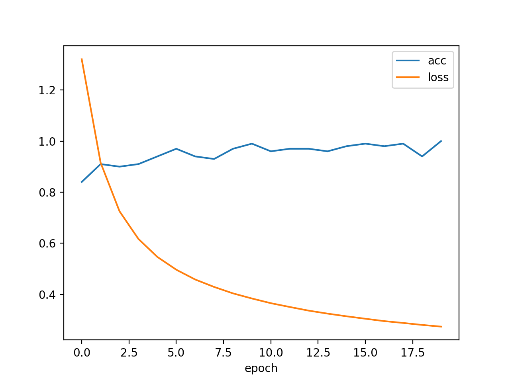

# week02 作业：五维向量多分类

**任务**：输入任意 5 维向量，最大值在第几维（下标 0~4）就属于第几类，共 5 类。
数据随机生成：`x = np.random.random(5)`，标签 `y = int(np.argmax(x))`。

**模型**：`nn.Linear(5, 5)` 输出 5 个类别的打分（logits）；
损失用 `nn.functional.cross_entropy`（内部自带 softmax，`forward` 里不再加 sigmoid / softmax）；
标签用 `LongTensor` 的类别下标（不是 one-hot），评估和预测时用 `argmax` 取类别。

**训练**：Adam，lr = 0.01，batch = 20，训练样本 5000，20 轮；每轮打乱样本顺序，固定随机种子 42，结果可复现。
（作为对比：训练样本 500 时测试准确率约 94%。）

**结果**：

- loss：1.32（第 1 轮）→ 0.27（第 20 轮）
- 测试集准确率：**1.000**（100 个新生成的样本）
- 训练曲线见 `train-curve.png`，模型权重保存为 `model.bin`

| 输入向量 | 真实类别 | 预测类别 | 概率 |
|---|---|---|---|
| [0.819, 0.152, 0.311, 0.035, 0.889] | 4 | 4 | 0.700 |
| [0.950, 0.552, 0.958, 0.955, 0.849] | 2 | 2 | 0.419 |
| [0.908, 0.675, 0.136, 0.347, 0.199] | 0 | 0 | 0.962 |
| [0.393, 0.594, 0.926, 0.416, 0.836] | 2 | 2 | 0.802 |

> 第 2 个向量的最大值 0.958 与次大值 0.955 只差 0.24%，两类得分接近，对应概率为 0.42。

**运行**：`python TorchDemo_多分类.py`（依赖 torch / numpy / matplotlib；训练完成后关闭图像窗口即打印预测结果）。
